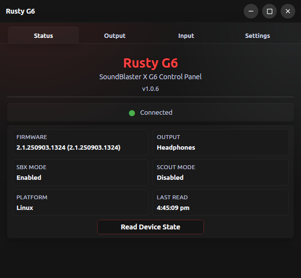
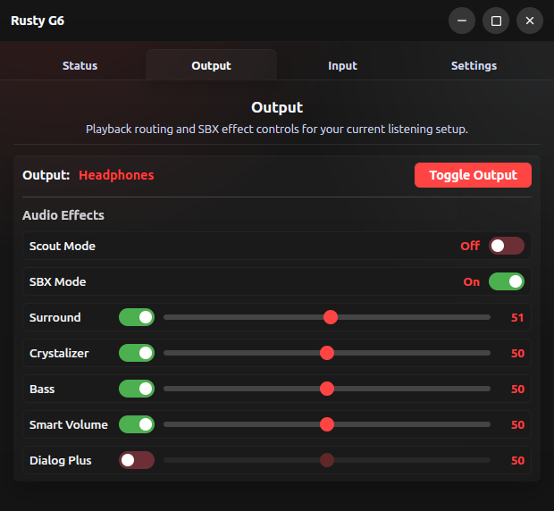
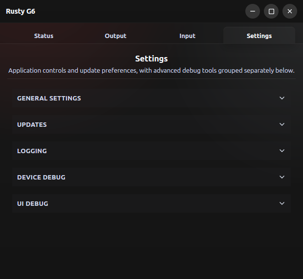

<p align="center">
  
</p>

<h1 align="center">Rusty G6</h1>

<p align="center">A simple control panel for the Sound BlasterX G6 on Linux and Windows.<br />Switch between speakers and headphones and tweak SBX effects, no command line needed.</p>

<p align="center">
  <a href="https://github.com/jackbrumley/rusty-g6/releases/latest"></a>
  
  <a href="LICENSE"></a>
</p>

<p align="center">
  <a href="https://brumley.info/rusty-g6/">Website</a> ·
  <a href="https://github.com/jackbrumley/rusty-g6/releases/latest">Downloads</a> ·
  <a href="docs/usb-protocol.md">USB protocol</a> ·
  <a href="https://github.com/jackbrumley/rusty-g6/issues">Report an issue</a>
</p>

## Install

**Linux**

```bash
curl --proto '=https' --tlsv1.2 -sSf https://brumley.info/rusty-g6/install.sh | bash
```

**Windows** (PowerShell)

```powershell
irm https://brumley.info/rusty-g6/install.ps1 | iex
```

Prefer a package? The [latest release](https://github.com/jackbrumley/rusty-g6/releases/latest) has a per-user Setup `.exe`, a system-wide `.msi`, and `.deb`, `.rpm` and `.AppImage` files. The Linux installer takes `-s -- --appimage` to install the AppImage on any distro.

## What it does

Rusty G6 is a control panel for the Sound BlasterX G6 USB DAC. Creative only makes its control app for Windows, so on Linux there was no way to switch outputs or change the SBX effects. Rusty G6 does both on Linux and Windows, in a small app that sits in the tray.

- Switch the G6 output between speakers and headphones
- Adjust SBX effects: Surround, Crystalizer, Bass, Smart Volume and Dialog Plus
- Shape the sound with the G6's 10-band graphic EQ: pick a preset or drag the curve
- Works on Linux, where Creative doesn't provide an app, and on Windows

## Screenshots

<p align="center">
  
  
</p>
<p align="center">
  
</p>

## Hardware

Rusty G6 talks to the Sound BlasterX G6 (USB `041e:3256`) over USB HID. On Linux the app asks for USB permission on first launch if it is missing. The protocol is reverse-engineered, building on [soundblaster-x-g6-cli](https://github.com/nils-skowasch/soundblaster-x-g6-cli) by [Nils Skowasch](https://github.com/nils-skowasch) and the hardware-verified protocol reference of [linuxblaster_control](https://github.com/RizeCrime/linuxblaster_control) by RizeCrime; use it at your own risk. Rusty G6 is not affiliated with Creative Technology.

## Build from source

```bash
npm install
npm run tauri:dev    # run in development
npm run tauri:build  # build packages for this platform
```

Packages land in `src-tauri/target/release/bundle/`. Prerequisites are in the [build guide](docs/build-guide.md).

## License

[GNU AGPLv3](LICENSE).

---

<p align="center">
  Rusty G6 is one of the free apps by <a href="https://brumley.info">Jack Brumley</a>:<br />
  <a href="https://voquill.org">Voquill</a> · <b>Rusty G6</b> · <a href="https://somedrive.org/">SomeDrive</a> · <a href="https://yambuck.com/">Yambuck</a> · <a href="https://brumley.info/rawtap/">RawTap</a> · <a href="https://bmuster.com/">BMuster</a>
</p>
